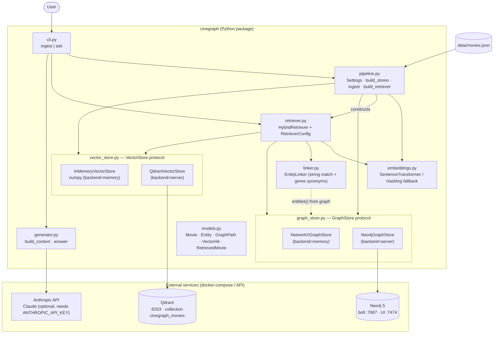

# CineGraph RAG

**Ask questions about movies, and get answers that follow real relationships, not just similar-sounding text.**

CineGraph RAG is a hybrid retrieval-augmented generation (GraphRAG) system. It combines a **knowledge graph (Neo4j)** that stores *who did what* with a **vector database (Qdrant)** that stores *what each story is about*, and hands an LLM a context that includes both, plus the graph paths that explain *why* each movie was picked.

> **In one sentence:** the vector search finds movies by *meaning*, the graph finds movies by *connections*, and the retriever merges the two before the LLM answers.

---

## Contents

- [Why this exists](#why-this-exists-the-problem-with-plain-vector-rag)
- [How it works, in plain English](#how-it-works-in-plain-english)
- [Architecture](#architecture)
- [How the two stores are joined](#how-the-two-stores-are-joined)
- [Scoring and fusion](#scoring-and-fusion)
- [Tech stack](#tech-stack)
- [Quick start](#quick-start-no-services)
- [With Neo4j + Qdrant](#with-neo4j--qdrant)
- [Example](#example)
- [Project layout](#project-layout)
- [Using your own data](#using-your-own-data)
- [Known limits and possible extensions](#known-limits-and-possible-extensions)

---

## Why this exists: the problem with plain vector RAG

Standard RAG embeds text chunks and retrieves the ones most similar to the question. That works for "what is this about?" questions, but it breaks down in three predictable ways:

| Failure mode | What goes wrong | How CineGraph handles it |
|---|---|---|
| **1. Multi-hop questions** | "Films **directed by Kapoor** *and* **starring Marcus Obi**" needs two explicit links: `Director → Movie ← Actor`. Embeddings flatten text, so they can't enforce an *AND* across relationships. | The graph traverses `DIRECTED_BY` and `ACTED_IN` edges directly. A movie reached from **both** named entities scores roughly twice as high as one reached from only one, so the intersection wins. |
| **2. Lost relationships between chunks** | If a movie's plot sits in one chunk and its cast list in another, a vector retriever often returns one without the other. | Plots live in the vector store; cast, director and genres live in the graph. Both are keyed by the **same `uid`**, so every hit is re-assembled with its full facts before it reaches the LLM. |
| **3. "More like this" and relatedness** | "Something like *Glass Harbor*" isn't about matching words; it's about shared directors, actors and genres. | The graph expands outward from the named movie (≤ 2 hops) and ranks neighbours by *how* they're connected (shared director > shared actor > shared genre). |

Each leg covers the other's blind spot: the graph knows nothing about plot, and the vectors know nothing about structure.

---

## How it works, in plain English

When you ask a question, five things happen:

1. **Understand the meaning.** The question is embedded and searched against plot embeddings in the vector store. → *"Which plots sound like this?"*
2. **Spot the names.** An entity linker finds people, genres and titles mentioned in the question (`"Rina Sato"`, `"sci-fi"`, `"Glass Harbor"`). → *"Which graph nodes did the user point at?"*
3. **Walk the graph.** Starting from those named entities, and from the top few plot matches, the retriever follows edges up to 2 hops and scores every movie it reaches by the paths that led there. → *"Which movies are actually connected to what was asked?"*
4. **Merge the rankings.** The semantic ranking and the graph ranking are fused into one list.
5. **Answer with evidence.** The winning movies are enriched with their graph facts (director, cast, genres, plot) and the connecting paths, then passed to Claude, which is told to answer **only** from that context and cite movies by title.

Because the graph paths are part of the context, every answer comes with an audit trail, e.g. `Dev Kapoor -[DIRECTED_BY]- Orbit of Ash`.

---

## Architecture

High-level flow:

```
┌──────────────┐                         ┌──────────────────────┐
│  User query  │                         │  data/movies.json    │
└──────┬───────┘                         └──────────┬───────────┘
       │                                            │ ingest (same uid → both stores)
       ▼                                  ┌─────────┴──────────┐
┌──────────────────┐                      ▼                    ▼
│ HybridRetriever  │            ┌──────────────────┐  ┌──────────────────┐
│ (retriever.py)   │──Cypher───▶│  Graph store     │  │  Vector store    │
│                  │  expand    │  Neo4j/NetworkX  │  │  Qdrant / numpy  │
│                  │◀───────────│  Movie·Person·   │  │  plot embeddings │
│                  │──search───────────────────────────▶                  │
│                  │◀──────────────────────────────────│                  │
└────────┬─────────┘            └──────────────────┘  └──────────────────┘
         │ fused, enriched results + graph paths
         ▼
┌──────────────────────────────────────────────────┐
│  generator.py: build_context → Claude            │
│  (answers only from retrieved graph + plot data) │
└──────────────────────────────────────────────────┘
```

Component view:



### The three layers

**A. Ingestion and knowledge graph** (`pipeline.py`, `graph_store.py`)
Each movie becomes a `:Movie` node linked to `:Person` and `:Genre` nodes:

```
(:Movie)-[:DIRECTED_BY]->(:Person)
(:Person)-[:ACTED_IN]->(:Movie)
(:Movie)-[:IN_GENRE]->(:Genre)
```

People are single nodes keyed by name (`person:<name>`), so someone who both directs and acts is one node with both kinds of edge. Neo4j enforces a uniqueness constraint on `uid`.

**B. Hybrid retrieval** (`retriever.py`, `linker.py`, `vector_store.py`, `embeddings.py`)
- *Dense leg:* `title + year + genres + plot` is embedded (sentence-transformers `all-MiniLM-L6-v2`, or a zero-dependency hashing fallback) and stored in Qdrant. Cast and director are deliberately **not** embedded; they belong to the graph.
- *Graph leg:* named entities and the top semantic hits become seeds for an N-hop neighbourhood expansion (Cypher variable-length paths in Neo4j, DFS in NetworkX).
- *Fusion:* the two rankings are merged (see [Scoring](#scoring-and-fusion)).

**C. Context assembly and generation** (`generator.py`)
For each result, the context lists the structured facts, the plot, the graph paths that connected it to the question, and which leg retrieved it. Claude is instructed to use only that context and to say so when the answer isn't there.

`CINEGRAPH_BACKEND=memory` runs everything in-process (NetworkX + numpy, no services); `server` uses Neo4j + Qdrant from `docker-compose.yml`. Ingestion, the graph schema and the full query sequence diagram are in [docs/ARCHITECTURE.md](docs/ARCHITECTURE.md).

---

## How the two stores are joined

Every movie is written to both stores under the same `uid` (e.g. `m08`). Graph nodes carry it as a property; Qdrant points carry it in their payload. That shared key is the whole trick: a vector hit can become a graph seed, and a graph neighbour can be scored and enriched without any lookup table.

```
                 query
                   │
       ┌───────────┴────────────┐
       ▼                        ▼
 embed + Qdrant search     entity linking
 (top semantic movies)     ("Rina Sato", "sci-fi", "Glass Harbor")
       │                        │
       │   top hits as seeds    │ named entities as seeds
       └──────────┬─────────────┘
                  ▼
        Neo4j path expansion (≤2 hops)
        score movies by the paths reaching them
                  │
                  ▼
     fusion: weighted blend (entities named) / RRF (pure semantic)
                  │
                  ▼
     enrich winners with graph facts → LLM context → answer
```

---

## Scoring and fusion

- **Named entities** (people, genres, titles found in the question): each path to a movie adds `hop_decay^(hops-1)`. A movie connected to *two* named entities scores ~2, one connected to one scores ~1, so intersections win.
- **Semantic seeds** (top-3 vector hits): expand "more like this" through the graph, weighted by similarity and by edge type (shared director 1.0 > actor 0.8 > genre 0.3, since genres are hubs that connect almost everything).
- **Fusion** (`--fusion auto`, the default):
  - when the query **names entities**, a scale-preserving weighted blend (raw cosine + graph score divided by its max), so the graph's "2 matches vs 1" gap stays meaningful;
  - for **pure-meaning** queries, Reciprocal Rank Fusion.
  - Both are available explicitly via `--fusion rrf|weighted`.

All knobs (`vector_k`, `seed_k`, `max_hops`, `hop_decay`, `rel_weights`, `rrf_k`, weights) live in `RetrieverConfig` in `cinegraph/retriever.py`.

---

## Tech stack

| Layer | Technology |
|---|---|
| Graph database | **Neo4j 5** (Cypher) · NetworkX for the in-memory backend and tests |
| Vector database | **Qdrant** (cosine) · numpy for the in-memory backend |
| Embeddings | `sentence-transformers` (`all-MiniLM-L6-v2`) · hashing fallback for offline use |
| Entity linking | String matching on node names + genre synonyms (`linker.py`) |
| LLM | **Claude** via the Anthropic API (optional; default `claude-sonnet-5-5`, override with `CINEGRAPH_LLM_MODEL`) |
| Interface | Command line (`python -m cinegraph ingest | ask`) |
| Orchestration | Plain Python, no framework; stores sit behind small `GraphStore` / `VectorStore` protocols |

---

## Quick start (no services)

```bash
pip install -e ".[dev]"
python -m cinegraph ask "sci-fi movies with Rina Sato" --context-only
pytest
```

The `memory` backend uses NetworkX + numpy and re-ingests on each run.

## With Neo4j + Qdrant

```bash
docker compose up -d
pip install -e ".[embeddings]"           # real sentence-transformers embeddings
export CINEGRAPH_BACKEND=server
python -m cinegraph ingest
python -m cinegraph ask "films directed by Kapoor starring Marcus Obi"
```

Browse the graph at http://localhost:7474 (`neo4j` / `cinegraph-pass`), e.g.
`MATCH p=(:Person {name:'Rina Sato'})-[:ACTED_IN]->(:Movie)-[:IN_GENRE]->(:Genre) RETURN p`.
Qdrant's dashboard is at http://localhost:6333/dashboard.

Set `ANTHROPIC_API_KEY` to get a generated answer after the retrieved context. See `.env.example` for all settings.

---

## Example

**Multi-hop: director AND actor**

```
$ python -m cinegraph ask "films directed by Kapoor starring Marcus Obi" -k 3 --context-only
Entities recognised in the question: Dev Kapoor (Person), Marcus Obi (Person)

[1] Quiet Frequency (2021)
    Director: Dev Kapoor
    Cast: Ada Lindqvist, Marcus Obi
    Graph link: Dev Kapoor -[DIRECTED_BY]- Quiet Frequency
    Graph link: Marcus Obi -[ACTED_IN]- Quiet Frequency
    Retrieved via: graph #1 (2.036)

[2] Orbit of Ash (2017)
    Director: Dev Kapoor
    Cast: Marcus Obi, Rina Sato
    Graph link: Dev Kapoor -[DIRECTED_BY]- Orbit of Ash
    Graph link: Marcus Obi -[ACTED_IN]- Orbit of Ash
    Retrieved via: semantic #6 (0.000), graph #2 (2.009)

[3] Red Valley Run (2013)
    Director: Bram Okafor
    Graph link: Marcus Obi -[ACTED_IN]- Red Valley Run
    Retrieved via: graph #6 (1.029)
```

The two films that satisfy *both* constraints score ~2 and rank first; a film matching only one (Obi, but not Kapoor) scores ~1 and falls behind. A pure vector search has no way to express that *AND*. (Output trimmed; the real context also includes genres and plot.)

**"More like this" via graph neighbours**

```
$ python -m cinegraph ask "something like Glass Harbor" -k 3 --context-only
Entities recognised in the question: Glass Harbor (Movie)

[1] The Lantern Keeper (2014)
    Graph link: Glass Harbor -[IN_GENRE]- Mystery -[IN_GENRE]- The Lantern Keeper
    Graph link: Glass Harbor -[ACTED_IN]- Rina Sato -[ACTED_IN]- The Lantern Keeper
    Graph link: Glass Harbor -[DIRECTED_BY]- Ines Moreau -[DIRECTED_BY]- The Lantern Keeper
    Retrieved via: graph #1 (1.168)
```

*The Lantern Keeper* shares a director, an actor and a genre with *Glass Harbor*, and the paths show exactly that.

---

## Project layout

| Path | What it does |
|---|---|
| `cinegraph/graph_store.py` | `Neo4jGraphStore` (Cypher) and `NetworkXGraphStore`, same interface |
| `cinegraph/vector_store.py` | `QdrantVectorStore` and `InMemoryVectorStore`, same interface |
| `cinegraph/embeddings.py` | sentence-transformers, with a hashing fallback for offline use |
| `cinegraph/linker.py` | string-match entity linker (people, genres, titles) |
| `cinegraph/retriever.py` | `HybridRetriever`: both legs + fusion + explanations |
| `cinegraph/generator.py` | builds the LLM context and calls Claude |
| `cinegraph/pipeline.py` | config, ingestion into both stores, wiring |
| `cinegraph/models.py` | shared data types and the `uid` scheme |
| `cinegraph/cli.py` | `ingest` and `ask` commands |
| `data/movies.json` | 16 fictional movies to play with |
| `tests/test_hybrid.py` | end-to-end retrieval tests (numpy and local Qdrant) |
| `docs/ARCHITECTURE.md` | ingestion, schema and query-sequence diagrams (Mermaid) |

---

## Using your own data

Replace `data/movies.json` (same fields: `id, title, year, director, cast, genres, plot`) or pass `--data path.json` to `ingest`. A Kaggle movie dataset works once mapped to those fields.

For other domains, keep the pattern:
1. a shared id on both stores,
2. a linker for your entity types,
3. edge weights that reflect how informative each relation is (hub-like relations such as genres should count less).

---

## Known limits and possible extensions

**Current limits**
- The hashing embedder is lexical only; install `sentence-transformers` for real semantic matching.
- The linker is plain string matching. For larger catalogues, swap in NER or an LLM-based linker.
- Graph queries use fixed Cypher templates, not free-form text-to-Cypher, so questions are limited to the patterns the retriever knows (named entities and "more like this").
- The Neo4j backend is written against the same tested interface but was not run against a live server in CI here; `docker compose up` and try it.

**Possible extensions (not built yet)**
- LLM-generated Cypher for open-ended questions (filters like year ranges, counts, aggregations).
- More entity types and edges, e.g. `:Studio` with `PRODUCED_BY`.
- A FastAPI endpoint or Streamlit UI that visualises the retrieved graph paths.
