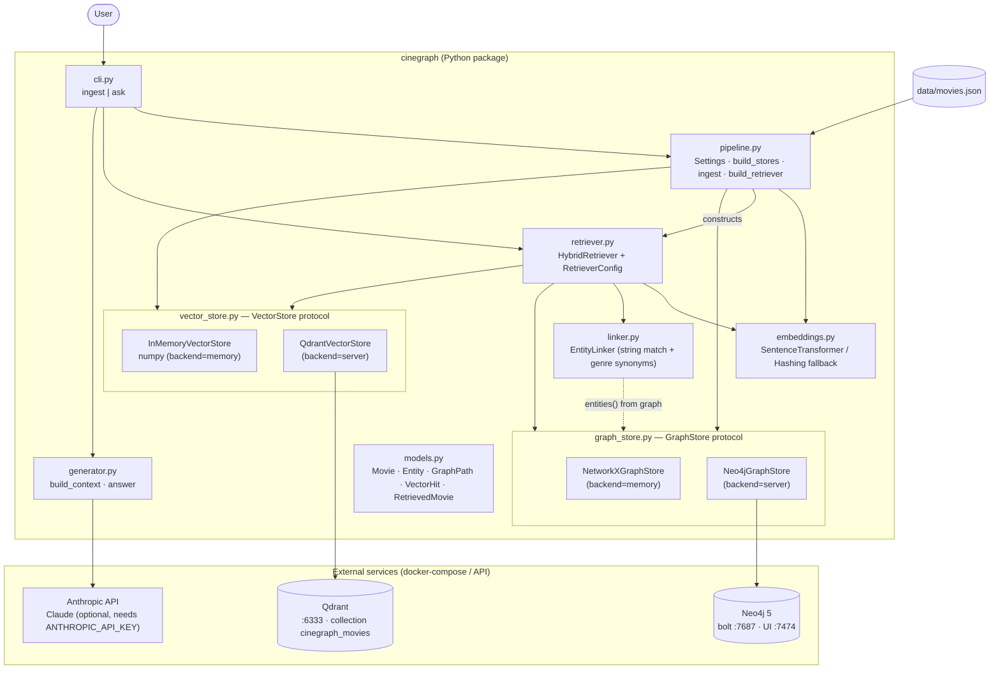
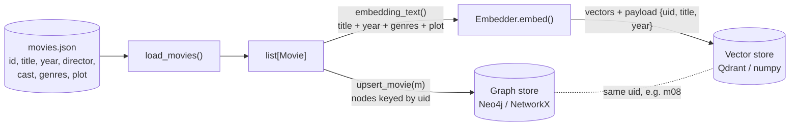
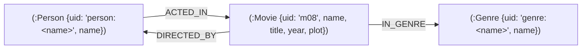
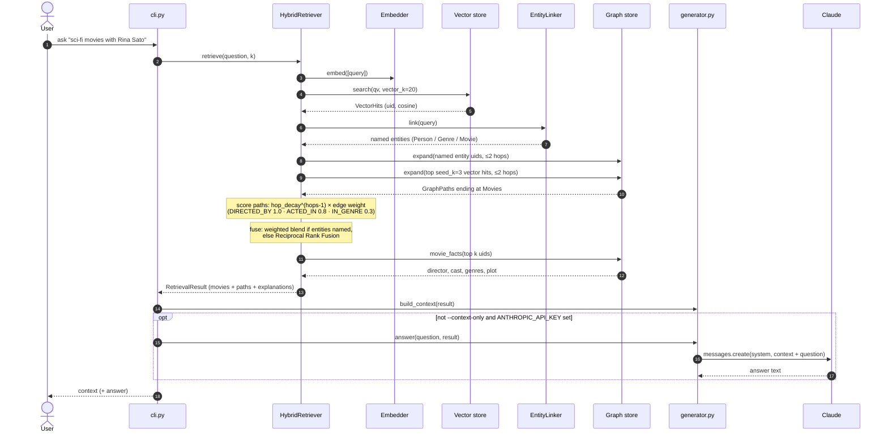

# Architecture

CineGraph RAG answers questions about a movie catalogue by combining a **graph store** (structure: who directed/acted in what, which genres) with a **vector store** (meaning: what the plot is about). Both stores hold every movie under the same `uid`, which is what lets results flow between them.

## System overview

`CINEGRAPH_BACKEND` picks the store pair: `memory` (NetworkX + numpy, re-ingested on every run, no services) or `server` (Neo4j + Qdrant from `docker-compose.yml`). `CINEGRAPH_EMBEDDER` picks `sentence-transformers` (all-MiniLM-L6-v2) or the lexical hashing fallback; `auto` uses the former if it is installed.

## Ingestion

Cast and director are deliberately **not** embedded: they live in the graph, so the vector leg stays about plot and theme.

## Graph schema

In Neo4j every node also has a `:Node` label, which carries a single uniqueness constraint on `uid`. Paths are traversed as undirected during retrieval.

## Query path (`cinegraph ask`)

All tunables (`vector_k`, `seed_k`, `max_hops`, `hop_decay`, `rel_weights`, `fusion`, `rrf_k`, weights) live in `RetrieverConfig` in `cinegraph/retriever.py`.
